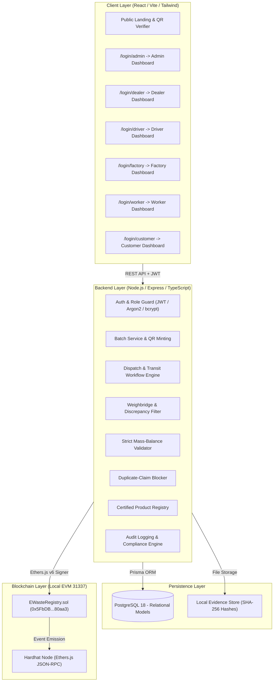
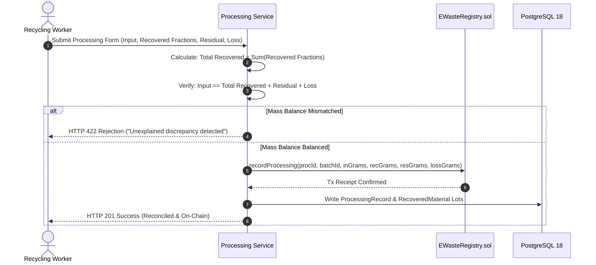

# EcoTrace System Architecture & Technical Specifications
**Hackathon Problem Statement**: WEB3-02 — E-Waste Lifecycle, Recovery and Audit Platform  
**Target Platform**: Kali Linux (Rolling 2026.3) / Antigravity IDE

---

## 1. High-Level Architecture Overview

EcoTrace is an end-to-end circular economy traceability platform integrating a local EVM blockchain with a relational PostgreSQL data store, Express TypeScript backend, and React/Vite web application.

---

## 2. Smart Contract Architecture (`EWasteRegistry.sol`)

The `EWasteRegistry` contract operates on local EVM (Chain ID: 31337) at address `0x5FbDB2315678afecb367f032d93F642f64180aa3`.

### Key Functions & On-Chain Rules:
1. `registerBatch`: Records unique batch ID, category, initial mass in grams, SHA-256 evidence hash, and destination facility. Reverts on duplicate batch IDs.
2. `createDispatch`: Links batches to a vehicle registration and driver. Sets status to `Dispatched`.
3. `recordReceiving`: Compares dispatched mass vs weighbridge measured mass. If there is a mismatch, flags dispute on-chain and updates batch state to `Disputed`.
4. `recordProcessing`: Enforces exact mass balance:
   $$\text{Input Weight} = \text{Total Recovered Output} + \text{Residual Waste} + \text{Documented Loss}$$
   Reverts with `MassBalanceMismatch` if the equation is violated.
5. `claimRecoveredMaterial`: Tracks available vs claimed material quantities. Reverts with `ClaimExceedsAvailableWeight` or `DuplicateClaimId` if double-counting or over-claiming occurs.
6. `registerRefurbishedProduct`: Stores serial number, source batch origin, condition grade, and inspection report hash for public customer verification.

---

## 3. Strict Mass-Balance Engine

The core reconciliation logic is implemented in both `backend/src/utils/massBalance.ts` and `EWasteRegistry.sol`:

---

## 4. Role Segregation & Access Matrix

| Role | Permitted Actions | Data Visibility |
|------|-------------------|-----------------|
| **ADMIN** | System-wide analytics, user role approval/suspension, duplicate-claim investigation, audit logs, CSV exports. | Complete global view across all facilities and batches. |
| **DEALER** | Register batches, generate QR manifests, upload weighing slips, dispatch batches. | Own collection batches and outbound dispatches. |
| **DRIVER** | View assigned trips, advance transit status (`Assigned` -> `Picked Up` -> `In Transit` -> `Delivered`), report incidents. | Only assigned dispatches and transport routes. |
| **FACTORY** | Gate intake, weighbridge measurement, dispute flagging, storage location allocation. | Shipments incoming to or processed at assigned facility. |
| **WORKER** | Disassembly, mass-balance entry, material fraction splits, refurbished product registration. | Work orders and inventory at assigned facility. |
| **CUSTOMER** | Search product by serial number / QR, verify condition, view warranty, view material provenance. | Public non-sensitive hardware verification details. |
